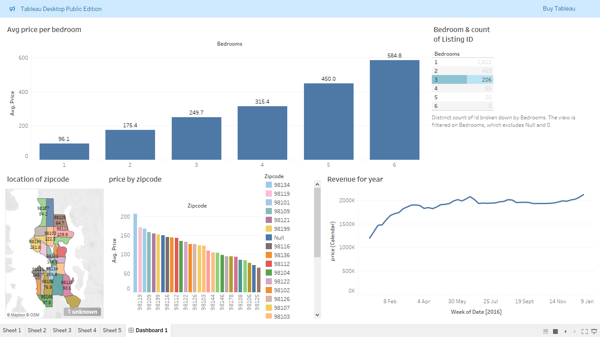

<h1 align="center">🏠 Airbnb Market Analysis</h1>
<h3 align="center">Interactive Tableau Dashboard: Pricing, Location and Seasonality</h3>

  
  
  

  

---

## 📑 Contents
[Overview](#-overview) · [Business Questions](#-business-questions) · [Dashboard at a Glance](#-dashboard-at-a-glance) · [Key Insights](#-key-insights) · [Process](#-process) · [Recommendations](#-recommendations) · [Files](#-files-in-this-folder) · [Author](#-author)

---

## 🎯 Overview

Short-term rental hosts, investors and guests all ask the same questions: **What should a listing cost? Where are the high-priced areas? When is demand strongest?**

This project answers those questions with an interactive **Tableau** dashboard built on Airbnb listing and calendar data for Seattle-area zip codes (2016). Five worksheets are combined into a single dashboard that updates as you click.

## ❓ Business Questions

1. How does the **average price** change with the **number of bedrooms**?
2. How many listings exist for each bedroom size?
3. Which **zip codes** are the most and least expensive?
4. Where are listings located, and how do prices look **on a map**?
5. How does **revenue change across the year**? Which weeks are strongest?

## 📊 Dashboard at a Glance

| Visual | Chart Type | What It Shows |
|--------|-----------|---------------|
| **Avg price per bedroom** | Bar chart | Average nightly price for 1 to 6 bedroom listings |
| **Bedroom and listing count** | Highlight table | Number of distinct listings for each bedroom size |
| **Location of zip code** | Filled map | Zip code areas labelled with their average price |
| **Price by zip code** | Colour-coded bar chart | Zip codes ranked from highest to lowest average price |
| **Revenue for the year** | Line chart | Weekly revenue trend through 2016 |

## 💡 Key Insights

### 1. 🛏️ More bedrooms means a higher price, and the jump is steep

| Bedrooms | Avg. Price | Listings |
|:--------:|:----------:|:--------:|
| 1 | **96.1** | 1,811 |
| 2 | **175.4** | 483 |
| 3 | **249.7** | 206 |
| 4 | **315.4** | 55 |
| 5 | **450.0** | 20 |
| 6 | **584.8** | 5 |

- Average price rises with every extra bedroom. A 6-bedroom listing costs about **6 times** as much as a 1-bedroom listing.
- **1-bedroom listings dominate the market** (1,811 of roughly 2,580 listings, about 70%).
- Large homes (5 and 6 bedrooms) are rare, which means little competition but a smaller group of guests.

### 2. 📍 Location drives price

- Average prices across zip codes range from about **65 to over 200**.
- **98134** is the most expensive zip code on the chart (about 207), followed by areas such as **98119** and **98109**.
- Lower-priced areas such as **98125** and **98177** sit at the bottom of the range.
- The map makes it easy to spot clusters of higher-priced areas close to the city centre.

### 3. 📈 Revenue is seasonal

- Revenue starts the year at its lowest, then **climbs steadily from February to April**.
- It reaches a **peak around late May to June**, which fits the start of the summer travel season.
- Revenue stays high through the rest of the year, with a small dip in late summer, and finishes with a **strong rise in January**.
- Hosts can use this pattern for pricing and availability planning.

### 4. 🔎 Data quality note

Some listings have a missing zip code (shown as *Null* and *1 unknown* on the map). The dashboard filters out missing and zero bedroom values.

## 🛠️ Process

**1. Data Preparation**
- Loaded the listings and calendar data into Tableau
- Checked for missing values (zip codes and bedrooms)
- Joined listing details with calendar prices

**2. Analysis (5 worksheets)**
- Average price by bedrooms
- Distinct count of listings by bedrooms
- Average price by zip code
- Map of zip codes with price labels
- Weekly revenue trend for the year

**3. Dashboard Design**
- Combined all worksheets into one dashboard (Dashboard 1)
- Added highlighting so selecting a bedroom size or zip code lets you explore the data
- Used clear titles and value labels so the story is readable at a glance

## ✅ Recommendations

| For | Recommendation |
|-----|----------------|
| 🏡 **Hosts** | Price against your bedroom count and zip code average. Raise prices in the strong spring and summer weeks |
| 💰 **Investors** | Compare high-priced zip codes with the number of listings to find areas with strong prices and room for new listings |
| 🏘️ **Property owners** | Larger homes earn much higher prices but are rare, so check demand before investing |
| 🧳 **Guests** | Book in the lower-demand months and in lower-priced zip codes for better value |

## 📂 Files in This Folder

| File | Description |
|------|-------------|
| `Airbnb full project 1 ....twbx` | Tableau packaged workbook (open in Tableau Desktop or Tableau Public) |
| `airbnb-dashboard.png` | Dashboard screenshot |
| `README.md` | Project documentation |

## 👤 Author

**Demilade Jeffricks** ("Dehmi the Analyst")

⭐ If you found this project useful, give the repo a star.
